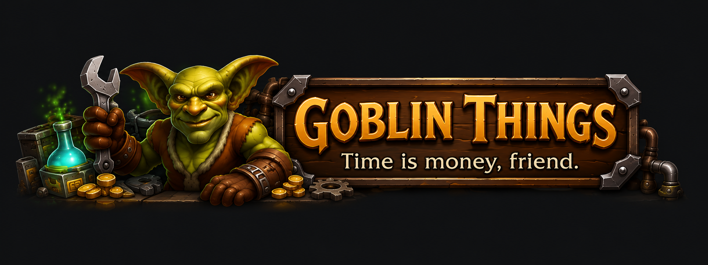
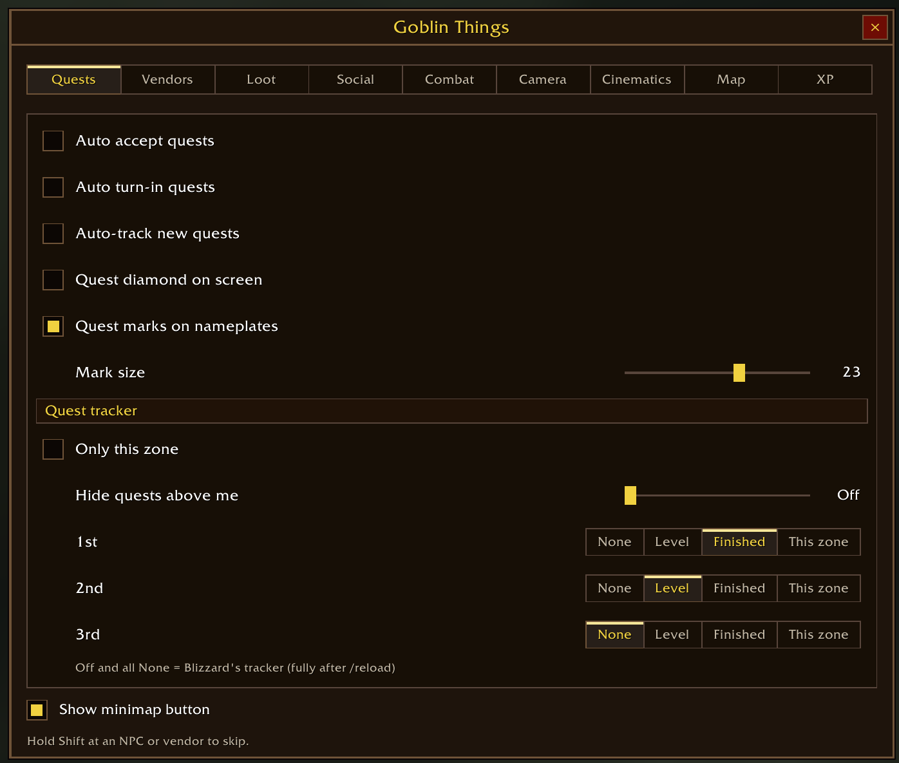
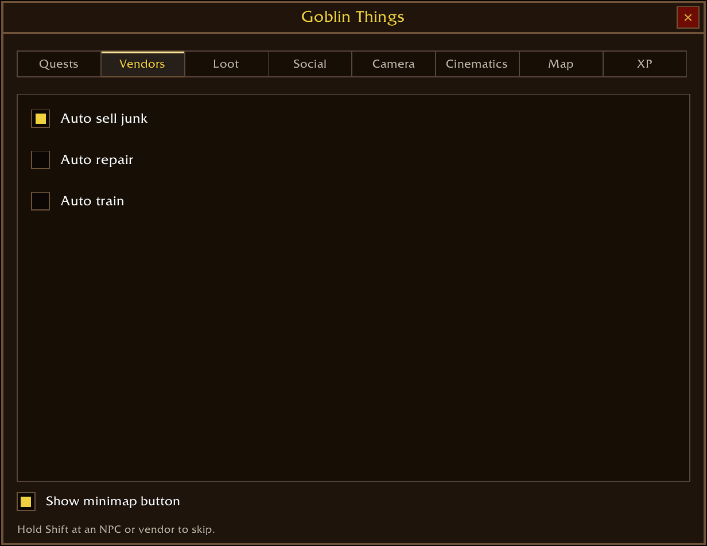
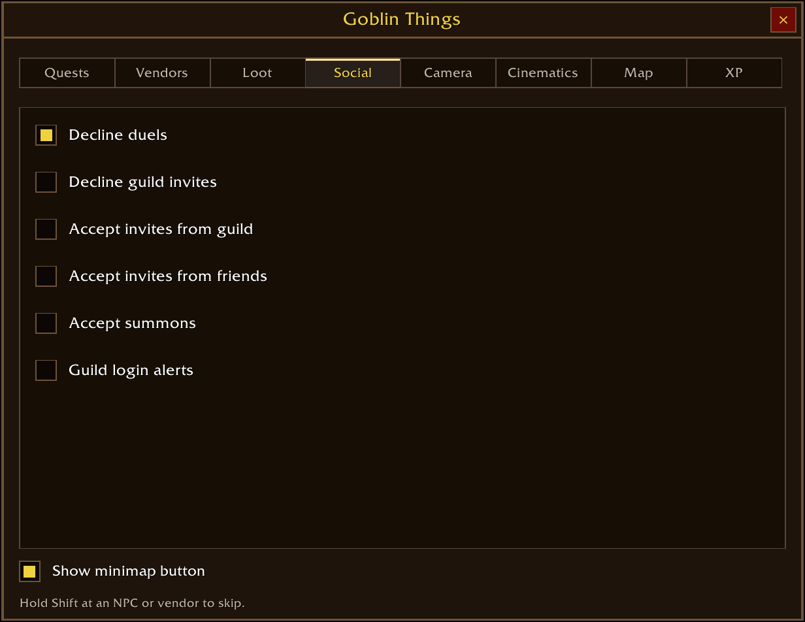
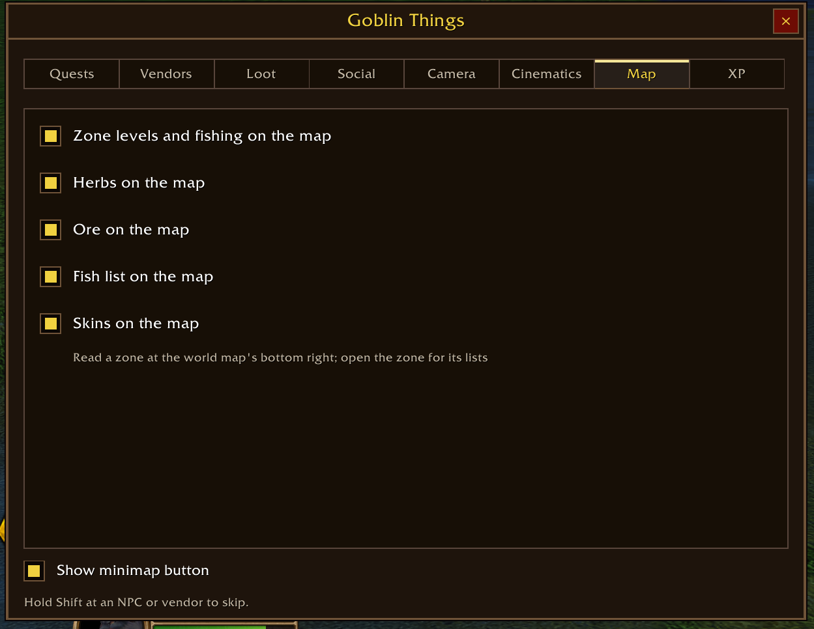
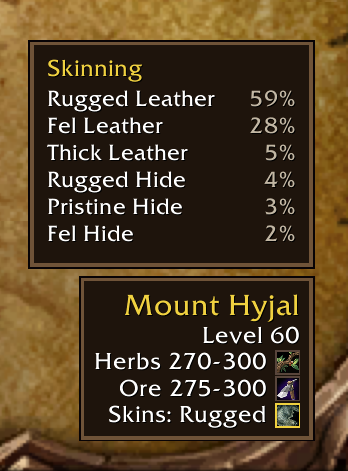

*Time is money, friend.*

Small goblin conveniences for **WoW Forever** (interface 16001): set them once in one tabbed window
and forget them.

| Tab | Switch | What it does | Starts |
|---|---|---|---|
| Quests | Auto accept quests | Takes offered quests, except gray, repeatable, dungeon, raid, group and PvP quests | On |
| | Auto turn-in quests | Hands in finished quests, except ones that cost gold or offer a reward choice | On |
| | Auto-track new quests | Keeps Blizzard's own auto-tracking on, even if another addon turns it off | Off |
| | Quest diamond on screen | The gold diamond and distance that point at your tracked quest. The game has it but ships it off, with no option of its own | Untouched |
| | Quest marks on nameplates | A gold ! above the nameplate of any mob one of your quests still wants, kill or drop, with how many of it are left to go (the smallest number when two quests want it). A slider sets the size | On |
| | Only this zone | The quest tracker shows only quests in the zone you're in | Off |
| | Hide quests above me | The quest tracker hides quests more than 1-20 levels (your pick) above you | Off |
| | Tracker sort | Orders the quest tracker by up to three tiers: Level (lowest first), Finished first, This zone first | Off |
| Vendors | Auto sell junk | Sells gray items at any vendor, with one chat line | On |
| | Auto repair | Repairs with your own gold at vendors who repair | On |
| | Auto train | Skips a trainer's lone "Train me" and trains everything you can afford at class and profession trainers; never takes up a new profession | Off |
| Loot | Fast loot | When the game auto-loots, takes everything at once instead of at the loot window's pace | On |
| | New items fill bags left to right | Which end of your bags new loot lands in. The game's own setting, which it gives no option for | Untouched |
| | Sort bags right to left | Which way the game's bag sort packs. The game's own setting, which it gives no option for | Untouched |
| | Always compare gear | Item tooltips show what you're wearing beside them without holding Shift | Untouched |
| Social | Decline duels | Refuses every duel request | Off |
| | Decline guild invites | Refuses every guild invite | Off |
| | Accept invites from guild | Joins a party or raid when a guild member invites you | Off |
| | Accept invites from friends | The same for your friends list and Battle.net friends | Off |
| | Accept summons | Takes a summon at once, unless you're in combat | Off |
| | Guild login alerts | Blizzard's own Guild Member Alert (the ding when a guildie logs in), here for convenience | On |
| Combat | Stop attacking on target change | Auto-attack stops when you pick a new target | Untouched |
| | Attack after /assist | Start attacking the target /assist gives you | Untouched |
| | Auto stand | Stand up by yourself when an action needs it | Untouched |
| | Auto dismount | Dismount by yourself when an action needs it | Untouched |
| | Auto leave shapeshift form | Drop your form by yourself when an action needs it | Untouched |
| | Target's cast bar | Shows the spell your target is casting | Untouched |
| | New spells go on the action bar | Whether a newly learned spell is put on your bars for you | Untouched |
| Camera | Camera distance | Zooms the camera out to 4.0, past Blizzard's 2.0 | Untouched |
| Cinematics | Skip cinematics | Off, repeats only, or all | Repeats only |
| Map | Zone levels and fishing on the map | On the world map, hover a zone (or open its map) to see its level range and the fishing skill it needs, bottom right | On |
| Map | Herbs on the map | Adds the zone's herbalism skill range to that readout; on the zone's own map, hover the line's icon to list each herb and the skill it needs | On |
| Map | Ore on the map | The same for mining: the skill range, and each vein with its skill | On |
| Map | Fish list on the map | On the zone's own map, an icon on the fishing line lists what is caught there and how often | On |
| Map | Skins on the map | Adds the leather grades the zone's beasts give to that readout ("Skins: Light, Medium"); on the zone's own map, hover the line's icon to list every leather, hide and scale skinned there and how common each is | On |
| Map | Dungeon and raid entrances on the map | On a zone's or city's own map, the game's blue swirl at each dungeon door and its green swirl at each raid door; hover one for the name and level range | On |
| Map | World map fades while moving | Whether the open world map turns see-through as you walk | Untouched |
| Map | Every tracking type on the minimap | The minimap's tracking menu offers every tracking type the game has | Untouched |
| XP | Kills to level | A faint number in a screen corner: how many more kills like your last ten it takes to level. Pick the corner, offsets, faintness, size and font | Off |

Hold **Shift** while talking to an NPC, a vendor or a trainer to skip everything that visit. Hold it on a
corpse to get the normal loot window. Everything else is one click in the window.

## Getting started

Click the goblin on the minimap, or type `/gt`. The window also opens from Esc > Options > AddOns >
Goblin Things.

| Command | Does |
|---|---|
| `/gt` | Opens the Goblin Things window |
| `/gt minimap` | Hides or shows the minimap button |
| `/gt probe` | Prints what the addon sees; include it in bug reports |

## Install

Install with the [Wago app](https://addons.wago.io/addons/goblin-things), or copy the `GoblinThings`
folder into `World of Warcraft\_forever_\Interface\AddOns\` and restart the game. Zips are on
the [releases page](https://github.com/CoffeeAndLoot/goblinthings/releases).

## How it behaves

- It never guesses. When the game will not answer a question (a quest's level, whether an inviter is
  a guildie), the addon leaves that thing alone and the normal window or popup appears.
- It says what it did in chat, once per thing: a sold stack, a repair, an accepted invite.
- An error in one feature is one chat line, once per session, and never a Lua error popup.

## For developers

`CLAUDE.md` has the rules, the architecture, and the test and lint commands; `docs/` has the design
specs, the in-game test checklist and the art spec. MIT licensed.
